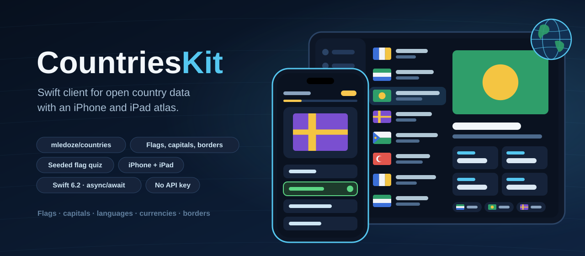
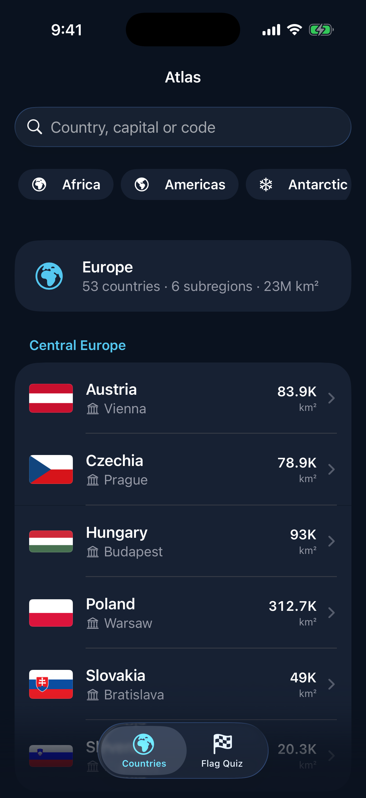
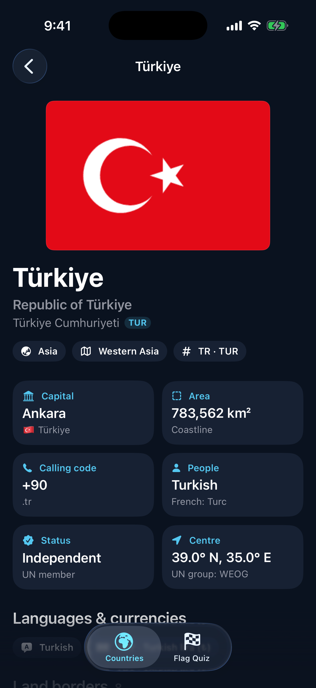
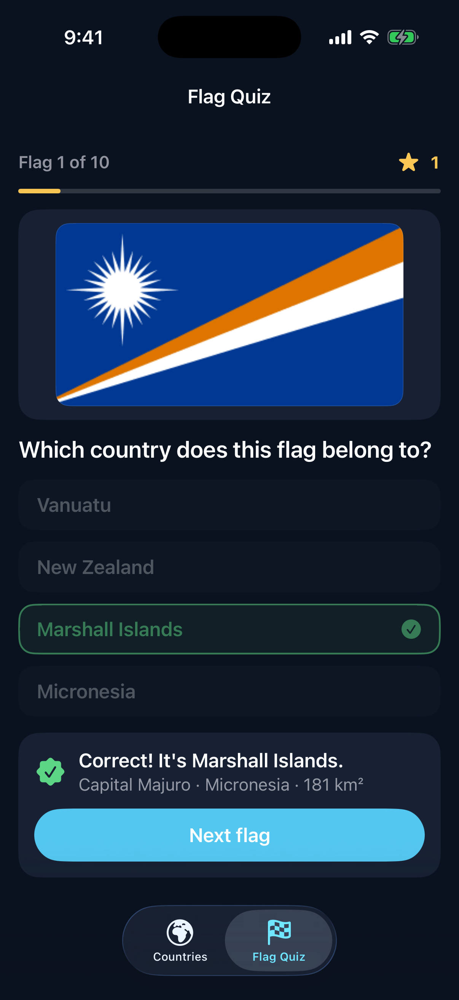
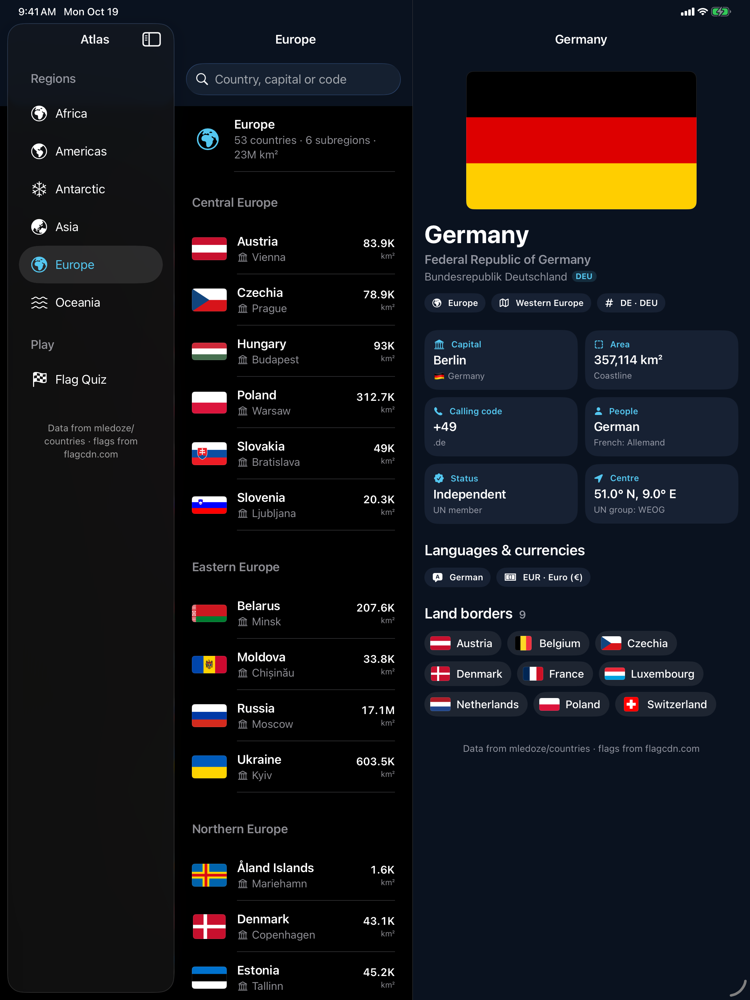

<p align="center">
  
</p>

<p align="center">
  <a href="https://github.com/halilozel1903/CountriesKit/actions/workflows/ci.yml"></a>
  
  
  
  
  
  <a href="LICENSE"></a>
</p>

**CountriesKit** is an async Swift client for open country data, with SwiftUI views and a demo atlas for **iPhone and iPad**. It loads the [mledoze/countries](https://github.com/mledoze/countries) dataset live (the data REST Countries was originally built from) and shows real flag images from [flagcdn.com](https://flagcdn.com). Lookups by any code, search by name, capital, currency, language, region, subregion, demonym and translated name, borders resolved to countries, flag URLs in any width, flag emoji, area formatting and a seeded flag quiz. No API key, no dependencies.

> **Where the data comes from.** Version 3.1 of the REST Countries API, which this package first used, has been retired: its URLs now answer with a deprecation notice, and the new version needs an account and a key. CountriesKit therefore reads the open dataset REST Countries was built from, straight from [jsDelivr](https://cdn.jsdelivr.net/gh/mledoze/countries@master/countries.json) (or GitHub, or your own mirror), and the flags from flagcdn.com. Both are free and need no key.

```swift
import CountriesKit

let api = CountriesClient()

let turkey = try await api.country(code: "TUR")
print(turkey.commonName, turkey.primaryCapital ?? "")      // "Türkiye Ankara"
print(turkey.formattedArea() ?? "")                        // "783,562 km²"
print(turkey.currencyList.map(\.description))              // ["Turkish lira (₺)"]
print(turkey.flagURL!)                                     // https://flagcdn.com/w320/tr.png

let neighbours = try await api.borders(of: turkey)
print(neighbours.map(\.commonName))                        // all eight, in order

let europe = try await api.countries(in: .europe)
for group in europe.groupedBySubregion() {
    print(group.name, group.countries.map(\.commonName))
}
```

## Screenshots

Captured by CI from the example app, *Atlas*, on an iPhone and an iPad simulator, with the real dataset loaded live from jsDelivr and the real flag PNGs from flagcdn.com. Nothing is bundled: if the data or a flag fails to load, the capture fails instead of showing placeholder data.

| Countries by region | Country page | Flag quiz |
| :---: | :---: | :---: |
|  |  |  |



## Features

- **Live, keyless data**: the client downloads the dataset (one JSON file, about 250 countries and territories) on first use, keeps it in memory for six hours (configurable) and answers every lookup and search from there. Calls made during the download share it, and `reload()` fetches a fresh copy.
- **Every lookup you need**: `all()`, `country(code:)` by cca2, cca3, ccn3 or cioc code, `countries(codes:)` in the order asked, and search by name (partial or exact), currency, language, region, subregion, capital, demonym and translated name, plus independent countries or territories. See the table below.
- **Models for everything the dataset has**: `Country` with `CountryName` (common, official and native names), translations, codes, independence and UN membership, the UN regional group, currencies, calling codes, capitals, alternative spellings, region and subregion, languages, coordinates, landlocked, borders, area, demonyms and the flag emoji. Every field is optional and decoding is lenient field by field: one odd value is `nil`, never a failed list. The models are `Codable` and encode back to the dataset's shape.
- **Real flags**: `flagURL` is the PNG on flagcdn.com (320 px wide), `flagPNGURL(width:)` gives any width from 20 to 2560 and `flagSVGURL` the SVG; `FlagCDN` builds them from any ISO code.
- **Borders resolved**: `borders(of:)` returns a country's neighbours in the order of its `borders` field. `borderCountries(in:)` does the same from a list you already hold, and `sharesBorder(with:)` checks both sides.
- **Helpers apps need**: `flagEmoji` (from the dataset, or made from `cca2` with `FlagEmoji`), `primaryCapital`, `regionValue`, `coordinate` and `distance(to:)`, `currencyList`, `languageList`, `nativeNames`, `translatedName(_:)`, `callingCodes` and `primaryCallingCode`, and `demonym`.
- **Formatting**: `CountryFormat.area` writes `783,562 km²` or, compact, `783.6K km²`; there is formatting for counts and distances too, all for any locale.
- **Lists**: `groupedBySubregion()`, `sortedByName()` (ignoring case and accents, so Åland Islands sorts with the A's), `matching(_:)` for search by name, capital, alternative spelling or code ("turkiye" finds Türkiye), `indexedByCode()` and `totalArea`.
- **A seeded flag quiz**: `FlagQuiz` makes questions from real countries with a `SeededGenerator` (SplitMix64, with its own shuffle), so the same seed gives the same flags and option order on every device and Swift version. Wrong answers come from the same region to make it harder.
- **Errors you can act on**: a search with no matches is an empty array, not an error; a lookup by an unknown code throws `notFound`; a failed download throws `http`, `transport` or `decoding`.
- **Optional SwiftUI**: the `CountriesUI` library has `FlagImage` (fits any flag shape, with the emoji while it loads and a swappable loader), `CountryRow` and `CountryChip`. The client works without it.
- **Testable and Swift 6 ready**: point the client at any `URLSession` and dataset URL. The package's own tests answer from a `URLProtocol` stub with 28 real records copied from the dataset, never the network. The client is `Sendable`; tested with Swift Testing on macOS and on an iOS simulator.

## API

| Method | Returns |
| --- | --- |
| `all()` | every country and territory, in the dataset's order |
| `country(code:)` | one `Country` by cca2, cca3, ccn3 or cioc code; throws `notFound` |
| `countries(codes:)` | `[Country]` in the order asked, unknown codes dropped |
| `countries(named:fullText:)` | names containing the text (common, official, native), or exact with `fullText` |
| `countries(currency:)` | by ISO 4217 code (`EUR`) or currency name |
| `countries(language:)` | by ISO 639-3 code (`spa`) or language name |
| `countries(in:)` | the countries of a `Region` |
| `countries(subregion:)` | by subregion, such as `Western Asia` |
| `countries(capital:)` | capitals containing the text |
| `countries(demonym:)` | by what the people are called, such as `Peruvian` |
| `countries(translation:)` | translated names containing the text, such as `Alemania` |
| `independentCountries(_:)` | independent countries, or with `false` the territories |
| `borders(of:)` | the neighbours, in the order of `borders` |
| `reload()` | downloads the dataset again |

Names, capitals and translations match ignoring case and accents.

## Installation

In Xcode choose **File › Add Package Dependencies…** and enter:

```
https://github.com/halilozel1903/CountriesKit
```

Or add it to `Package.swift`:

```swift
dependencies: [
    .package(url: "https://github.com/halilozel1903/CountriesKit", from: "1.0.0")
],
targets: [
    .target(name: "MyApp", dependencies: [
        .product(name: "CountriesKit", package: "CountriesKit"),
        .product(name: "CountriesUI", package: "CountriesKit"),   // optional SwiftUI views
    ])
]
```

## Usage

### Looking countries up

```swift
let api = CountriesClient.shared

let japan = try await api.country(code: "JP")                  // cca2, cca3, ccn3 or cioc
let few = try await api.countries(codes: ["DEU", "fr", "380"])  // in this order
let found = try await api.countries(named: "united")            // every partial match
let exact = try await api.countries(named: "Germany", fullText: true)
let euro = try await api.countries(currency: "EUR")
let spanish = try await api.countries(language: "spa")
let westAsia = try await api.countries(subregion: "Western Asia")
let territories = try await api.independentCountries(false)

let nobody = try await api.countries(named: "zzzz")             // [], not an error
```

The first call downloads the dataset; the others are answered from memory.

### Where the data is loaded from

```swift
// The default: jsDelivr, which serves the file from GitHub through a CDN.
CountriesConfiguration.jsDelivrURL
// https://cdn.jsdelivr.net/gh/mledoze/countries@master/countries.json

// The same file straight from GitHub.
let api = CountriesClient(configuration: CountriesConfiguration(
    datasetURL: CountriesConfiguration.gitHubRawURL,
    cacheLifetime: 24 * 60 * 60
))
// https://raw.githubusercontent.com/mledoze/countries/master/countries.json
```

Pin a tag or commit of the dataset (`…/gh/mledoze/countries@<tag>/countries.json`) or point `datasetURL` at your own mirror when you want the data never to change under you.

### The model

```swift
let turkey = try await api.country(code: "TUR")

turkey.name?.official                    // "Republic of Türkiye"
turkey.nativeNames                       // [LocalizedCountryName], one per official language
turkey.translatedName("deu")?.common     // "Türkei"
turkey.flagURL                           // https://flagcdn.com/w320/tr.png
turkey.flagPNGURL(width: 640)            // https://flagcdn.com/w640/tr.png
turkey.flagSVGURL                        // https://flagcdn.com/tr.svg
turkey.flagEmoji                         // "🇹🇷", from `flag` or made from cca2
turkey.coordinate                        // Coordinate(latitude: 39, longitude: 35)
turkey.borders                           // ["ARM", "AZE", "BGR", …] as cca3 codes
turkey.primaryCallingCode                // "+90"
turkey.currencyList                      // [CurrencyInfo(code: "TRY", name: "Turkish lira", symbol: "₺")]
turkey.languageList                      // [Language(code: "tur", name: "Turkish")]
turkey.demonym                           // "Turkish"
turkey.independent                       // true
turkey.unMember                          // true
turkey.unRegionalGroup                   // "Western European and Others Group"
```

### Borders

```swift
let neighbours = try await api.borders(of: turkey)   // in the order of `borders`

// Or from a list you already hold.
let world = try await api.all()
let sameNeighbours = turkey.borderCountries(in: world)
turkey.sharesBorder(with: neighbours[0])   // true
```

An island answers `[]`.

### Formatting

```swift
CountryFormat.area(783_562)                                // "783,562 km²"
CountryFormat.area(783_562, style: .compact)               // "783.6K km²"
CountryFormat.number(17_098_246, style: .compact)          // "17.1M"
CountryFormat.distance(1_234)                              // "1,234 km"
FlagEmoji.emoji(forRegionCode: "NO")                       // "🇳🇴"
```

All of them take a `locale:`.

### A flag quiz

```swift
let countries = try await api.all()
let quiz = FlagQuiz(countries: countries, questionCount: 10, optionCount: 4,
                    seed: 2026, independentOnly: true)

let question = quiz.questions[0]
question.answer.flagURL            // the flag to show
question.options                   // four countries, the answer among them
question.isCorrect(question.options[1])
quiz.score([1: question.options[1]])
```

The same countries and seed always give the same quiz, so you can offer a daily challenge by seeding with the date. The demo app does.

### SwiftUI

```swift
import CountriesUI

List(europe) { country in
    CountryRow(country: country)        // flag, name, capital, area
}

FlagImage(country: turkey)              // fitted, never cropped
    .frame(height: 180)

CountryChip(country: neighbour)         // small flag and name in a capsule
```

`FlagImage` loads through the `flagImageLoader` in the environment; swap in your own cache with `.flagImageLoader(FlagImageLoader { url in … })`.

### Errors

```swift
do {
    _ = try await api.country(code: "ZZZ")
} catch CountriesError.notFound(let code) {
    print("No country has the code", code)
} catch CountriesError.http(let status, _) {
    print("The dataset download failed with", status)
} catch CountriesError.transport(let error) {
    print("Offline?", error.code)
}
```

### Testing your code

```swift
let configuration = URLSessionConfiguration.ephemeral
configuration.protocolClasses = [MyStubProtocol.self]
let api = CountriesClient(configuration: CountriesConfiguration(
    datasetURL: URL(string: "https://stub.test/countries.json")!,
    session: URLSession(configuration: configuration)
))
```

## Example app

`Example/` holds *Atlas*, a SwiftUI app for iPhone and iPad built with this package. On iPhone it has tabs for the countries of each region (grouped by subregion, with search) and the flag quiz; on iPad a three-column split view with regions, countries and the country page. Country pages show the flag, names, facts, languages, currencies and land borders, and every neighbour opens its own page.

```bash
brew install xcodegen
cd Example && xcodegen generate && open CountriesAtlas.xcodeproj
```

## Requirements

- Swift 6.2, Xcode 26
- iOS 17 and iPadOS 17 or later (macOS 14 for running the tests)

## Credits

Country data from [mledoze/countries](https://github.com/mledoze/countries) by Mohammed Le Doze and contributors (ODbL 1.0), served by [jsDelivr](https://www.jsdelivr.com). Flag images from [flagcdn.com](https://flagcdn.com). REST Countries, whose v3.1 API this package first used, was built on the same dataset. This package is not affiliated with any of them.

## License

MIT. See [LICENSE](LICENSE). The country data is licensed separately under the Open Database License by its authors.
